# NeonWatch

**A health monitor for one Linux workstation, in your browser.** A root agent that only reads
sweeps your hardware, logs, firewall, network, processes, services and containers. Deterministic
rules raise the alarms. An optional local model ranks what rules cannot judge. A loopback
dashboard shows what needs attention, live.


[](LICENSE)

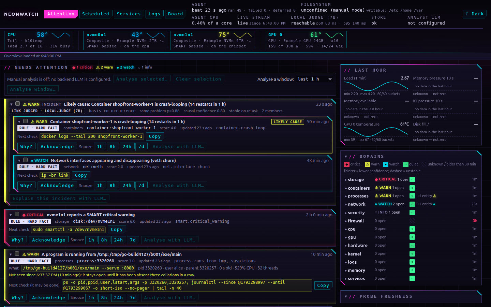

<sub>Screenshots are rendered from synthetic data by `scripts/make-screenshots.py`.</sub>

> [!NOTE]
> **Early.** NeonWatch has been developed on, and has only run on, one Ubuntu-based workstation
> (Linux Mint 22, kernel 6.8, an AMD CPU, NVIDIA GPUs, NVMe drives). It assumes a single-user
> machine. Expect rough edges elsewhere, and please report them.

## How it fits together

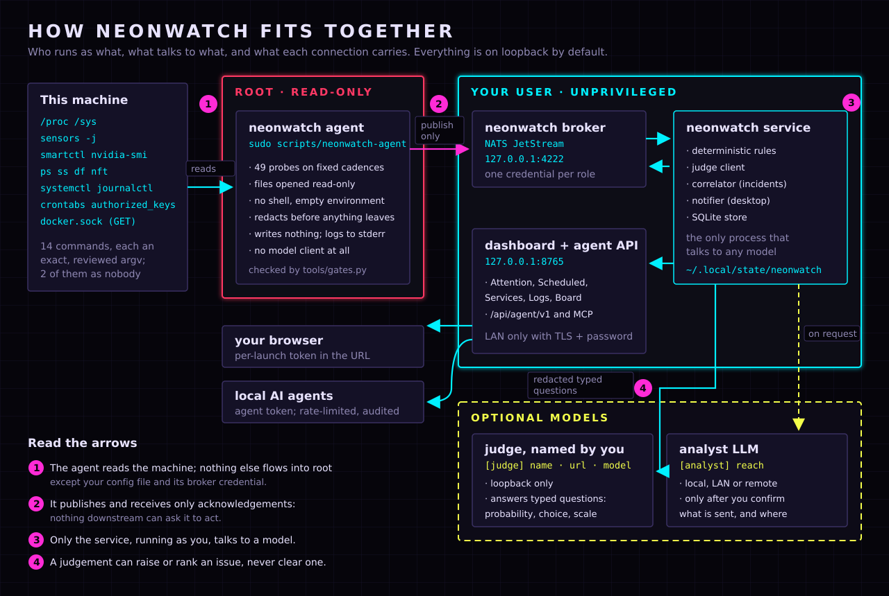

| Process | Runs as | Talks to | Writes |
| --- | --- | --- | --- |
| `scripts/neonwatch-agent` | root, via `sudo` | the broker, publish-only | nothing: it logs to stderr |
| `neonwatch broker` | you | the agent and the service, on loopback | `~/.local/state/neonwatch/broker/` |
| `neonwatch service` | you | the broker, the judge, the analyst, your browser | `~/.local/state/neonwatch/`, and the Models tab's two files in `~/.config/neonwatch/` |
| judge, analyst | whatever you run them as | the service | not NeonWatch's concern |

## What you get

| View | What it shows | Sends anything to a model? |
| --- | --- | --- |
| **Attention** | Open issues ranked by severity. Each says what happened (the evidence it was raised on, kept even after the thing is gone), whether it is still there, and a check to copy (never run for you). Related issues are grouped into incidents under a likely cause. Domain health and the last hour of key readings. | Only if you press *Analyse* and confirm |
| **Scheduled** | Every cron job and systemd timer, with the judge's verdict on each. | Only *Analyze*, after you confirm |
| **Services** | Every loaded systemd service, with state and restarts. | Only *Describe…* or *Analyze*, after you confirm |
| **Logs** | The last 200 journal lines, read when you press *Load* and filterable by priority. | Only *Explain…*, after you confirm |
| **Board** | Your motherboard from above, each CPU, drive and GPU coloured by temperature against its own limit. | No |
| **Models** | Which judge and analyst the service calls, where each setting comes from, and whether each has a key. Changes apply without a restart (see *Configure*). | No |

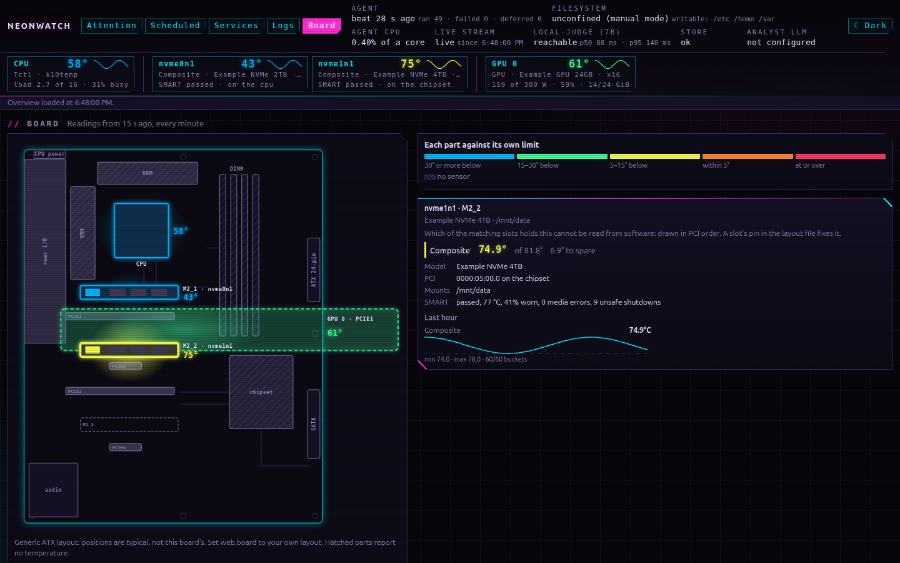

## Before you run it as root

The agent runs as root so it can read what only root can. This is what you can rely on, and
what enforces each part:

- **Its work is fixed and model-free.** It runs a closed catalog of probes on a schedule. No
  model output reaches it, and it never talks to the judge or the analyst.
- **NeonWatch's root code is checked statically.** `tools/gates.py` holds each NeonWatch module
  that runs as root to an allowlist of imports and attributes. It refuses any file open that is
  not read-only, and any command that is not one of the reviewed command lines below. CI runs it
  on every pull request and every push to `main`.
- **The agent refuses anything else at run time.** It runs a command only if it matches a catalog
  entry exactly, with no shell and an empty environment, and only from a root-owned binary. It
  opens files `O_RDONLY | O_NOFOLLOW`, and it talks to Docker with `GET` only.

Two more hold only when the agent runs as a system service (see *Run as services*):

- **Kernel enforcement.** The unit gives the agent a read-only filesystem, loopback-only
  networking and a fixed capability set, and the agent refuses to start if its write canary finds
  anything writable. Started by hand, it is an ordinary root process, and the dashboard says so:
  *unconfined (manual mode)*.
- **Root runs nothing your account can change.** The unit runs a root-owned copy in
  `/opt/neonwatch`, on the system Python. By hand, `sudo scripts/neonwatch-agent` runs the clone's
  `.venv` Python, its libraries and the NeonWatch source, all of which belong to your user (and so
  may the interpreter, if uv downloaded it): anything that can write as you can change what runs
  as root the next time you start it. Installing the service trusts your account once, at that
  moment. Run the checks below before either.

What this does **not** give you:

- **Coverage of other code.** The gates scan NeonWatch's code, not the NATS client library or the
  Python standard library. The external commands are trusted to do what their reviewed flags
  say. Two that changed the host when run as root (`nvidia-smi` and `apt-get`) run as `nobody`.
- **Perfect redaction.** Secret-shaped text (tokens, keys, `password=…`, credentials in URLs) is
  masked before anything leaves root, and again before anything goes to a model. A password
  passed positionally is not caught. Hostnames, usernames, IP addresses, command lines, crontabs
  and unit files are not redacted.

<details>
<summary><b>Exactly what runs as root, what it reads, and what it writes</b></summary>

One process, `.venv/bin/python -I -B -m neonwatch.launch agent`, whose children are these
commands, each an exact command line from `APPROVED_ARGV` in [`tools/gates.py`](tools/gates.py):

| Every | Command | As |
| --- | --- | --- |
| 60 s | `/usr/bin/sensors -j` | root |
| 60 s | `/usr/bin/nvidia-smi --query-gpu … --format=csv,noheader,nounits` | nobody |
| 60 s | `/usr/bin/df -l -B1 -x squashfs -x overlay -x efivarfs -x devtmpfs --output=…` | root |
| 5 min | `/usr/bin/ps -e -o pid=,ppid=,user:32=,…,args=` | root |
| 5 min | `/usr/bin/systemctl list-units --failed -o json --no-pager` | root |
| 5 min | `/usr/bin/journalctl -q -p warning -o json --output-fields=… --no-pager -n 500 --since -6min` | root |
| 5 min | `/usr/bin/journalctl -q -p err -o json --output-fields=… --no-pager -n 200 --since -6min` | root |
| 5 min | `/usr/bin/ss -ltnupH` | root |
| 1 h | `/usr/sbin/smartctl -j -a /dev/<disk>`, once per `nvme…n…` or `sd…` device | root |
| 1 h | `/usr/sbin/nft -j list ruleset` | root |
| 1 h | `/usr/bin/apt-get -s dist-upgrade` (simulate only) | nobody |
| 1 h | `/usr/bin/systemctl list-timers --all -o json --no-pager` | root |
| 1 h | `/usr/bin/systemctl show --all -p Id,Description,User,ExecStart,… '*.service' '*.timer'` | root |
| 24 h | `/usr/bin/systemctl list-unit-files -o json --no-pager` | root |

It also reads files under `/proc` and `/sys`, the system and per-user crontabs (`/etc/cron*`,
**every user's** `/var/spool/cron/crontabs/*`), **every** `authorized_keys` under `/home/*/.ssh/`
and `/root/.ssh/`, the names in `/boot`, and `/var/run/reboot-required*`. It makes one
`GET /containers/json?all=1` on the Docker socket. It does not read `/etc/shadow`, private keys or
the contents of home directories. The catalog with every probe is
[`neonwatch/probes/catalog.py`](neonwatch/probes/catalog.py).

**Root writes nothing:** no log, pid, state or bytecode file. Everything below is written by you,
and **it holds what root read**, redacted: other users' crontabs, every command line, the
firewall ruleset, journal lines. Treat your account accordingly.

| Path | Written by | Holds |
| --- | --- | --- |
| `.venv/`, `.tools/nats-server` | `uv sync`, `scripts/fetch-nats-server` | the code and the broker, in the clone |
| `~/.local/state/neonwatch/broker/` (0700) | `neonwatch broker` | the broker's config, a 0600 credential per role, its message store |
| `~/.local/state/neonwatch/store.sqlite3` (0600) | `neonwatch service` | the dashboard's database |
| `~/.local/state/neonwatch/agent.token` (0600) | `neonwatch service` | the agent API's token |
| `~/.local/state/neonwatch/dashboard.url` (0600) | `neonwatch service` | the dashboard URL and its token, while the service runs |
| `~/.config/neonwatch/models.json`, `secrets.json` (0600) | `neonwatch service`, from the Models tab | the models and the keys set from the dashboard |

The message store and the database each keep 7 days or 10 GiB, whichever comes first
(`[retention]`).

**What leaves the machine.** At install time, `uv sync` fetches packages, and
`scripts/fetch-nats-server` downloads nats-server v2.15.0 from GitHub, checked against a SHA-256
pinned in the script. `scripts/install-agent` downloads the nats-py wheel that `uv.lock` pins, from
PyPI, checked against its hash there. At run time, by default, **nothing**: the broker, the judge,
the dashboard and the agent API are all on loopback. Only if you configure it: an analyst on your LAN or the
internet (`reach = "lan"` or `"remote"`), and a LAN dashboard.

</details>

**Check it yourself**, as yourself, from the clone:

```sh
.venv/bin/python tools/gates.py      # expect: gates: all hold
git status && git log -1             # the code you are about to run as root
.venv/bin/python -B -c 'from neonwatch.probes import CATALOG
for s in CATALOG: print(s.tier.value, "nobody" if s.unprivileged else "root  ", " ".join(s.argv) or s.path)'
```

The last command prints all 49 probes the agent will run, each with the user it runs as.

## Quick start

**You need:** Linux with systemd on x86_64 or arm64, [uv](https://docs.astral.sh/uv/) (it can
fetch Python 3.12 or 3.13 for you), `curl`, `tar`, `sha256sum` and `sudo`. Optional, each read by
its own probe, and simply reported missing if absent: `lm-sensors`, `smartmontools`,
`nvidia-smi`, Docker, `nftables`.

### 1. Install, as yourself

```sh
git clone https://github.com/drobison00/NeonWatch.git neonwatch
cd neonwatch
uv sync                      # never as root
scripts/fetch-nats-server    # the pinned NATS server, into .tools/
```

You should see `nats-server-v2.15.0-linux-amd64.tar.gz: OK` (or `arm64`), then a version line.

### 2. Start three processes, in this order

Use one terminal each. The broker makes the credentials the other two use, and the service
creates the stream the agent publishes to.

| | Command, from the clone's root | You should see |
| --- | --- | --- |
| **1** | `.venv/bin/neonwatch broker` | nats-server's `Server is ready`, listening on `127.0.0.1:4222` |
| **2** | `.venv/bin/neonwatch service` | a URL, `http://127.0.0.1:8765/?token=…` |
| **3** | `sudo scripts/neonwatch-agent` | `observing for <you> (uid <n>): 49 probes, publishing to nats://127.0.0.1:4222 …` |

Open the URL the service printed. It carries a token that changes every time the service starts.
After the first visit the token lives in a cookie. To look from another machine, an SSH tunnel
(`ssh -L 8765:127.0.0.1:8765 <this host>`) is simpler and safer than LAN mode. The same URL is
in `~/.local/state/neonwatch/dashboard.url` (readable by you alone) while the service runs.

Views and issues have addresses, so a link can open one: `#/view/attention`, `scheduled`,
`services`, `logs`, `board` or `models`, and `#/issues/<id>`, which scrolls to that issue's card
and marks it. An issue that is no longer open says what became of it in the status line. Back and forward
move between them.

### 3. What a healthy first run looks like

> [!IMPORTANT]
> On a fresh start, these are **expected**, not faults:
> - **Filesystem: unconfined (manual mode)**, and an INFO issue saying the same, when you
>   started the agent by hand: it is not kernel-confined then (see above).
> - **Judge: not asked yet**, then **unreachable** after the first collation: no judge is
>   configured. Everything else works without one.
> - **Analyst LLM: not configured**, and the *Analyse* buttons greyed out.
> - **Needs attention** starts empty and fills at the first collation, within 5 minutes. The
>   hardware strip and the Board fill within a minute.

### 4. Stop, and uninstall

Stop each with Ctrl-C: **the agent first** (it waits for a missing broker forever), then the
service, then the broker. To remove everything:

```sh
rm -rf ~/.local/state/neonwatch        # broker data, credentials, the database, the agent token
rm -rf ~/.config/neonwatch             # your config, the models and keys set from the dashboard, any TLS key you made
claude mcp remove --scope user neonwatch   # only if you registered the MCP server
rm -rf /path/to/the/clone
```

Root wrote nothing, so nothing needs cleaning under `/etc`, `/var` or `/root`. If you installed
the services, remove them first (below).

### Run as services

The three terminals above are fine for trying it out. To keep NeonWatch running, install it as
three systemd units. They start at boot and restart after a failure.

| Unit | Runs | As | Installed by |
| --- | --- | --- | --- |
| `neonwatch-agent@<you>.service` | the root agent, from a root-owned copy in `/opt/neonwatch`, in a read-only sandbox | root | `scripts/install-agent` |
| `neonwatch-broker.service` | the NATS broker, from your clone | you (`systemctl --user`) | `tools/services.py install-user` |
| `neonwatch-service.service` | the evaluator, judge client and dashboard, from your clone | you (`systemctl --user`) | `tools/services.py install-user` |

Run every step from the clone the units should run. Nothing here needs the three hand-started
processes, so stop them first: Ctrl-C in each terminal, the agent first.

**1. The agent, as a system unit.** As yourself; it asks sudo for the one step that needs root:

```sh
scripts/install-agent
```

It builds NeonWatch's wheel and downloads the nats-py wheel `uv.lock` pins (checked against its
hash) into `dist/agent` as you, then asks sudo to run
`tools/services.py install-agent --operator <you>` on the system Python, isolated. That copies
the bundle somewhere only root can write and checks every hash. It builds `/opt/neonwatch.new`,
imports the agent from it, and refuses unless every file is root's and writable by nobody else.
Then it swaps the copy into `/opt/neonwatch` (the previous one becomes `/opt/neonwatch.old`) and
writes and enables the unit. The script starts the unit if it isn't running, and shows its status.
You should see `active (running)` and the agent's first line:
`observing for <you> (uid <n>): 49 probes, …`. The unit's interpreter is the system's
`/usr/bin/python3`, which must be root's and 3.12 or 3.13 (what `pyproject.toml` requires);
`install-agent` refuses one that is not root's.

**2. The broker and the service, as user units.** As yourself:

```sh
python3 tools/services.py install-user
systemctl --user start neonwatch-service       # starts the broker too
systemctl --user status neonwatch-broker neonwatch-service --no-pager
```

`install-user` writes both units into `~/.config/systemd/user/`, pointing at this clone, and
enables them. It refuses unless the clone has `.venv/bin/neonwatch` and `.tools/nats-server`
(`uv sync` and `scripts/fetch-nats-server`). It starts nothing, so a hand-started broker or service
is never doubled. Both units should be `active (running)`.

**3. Keep them running when you are logged out.** Without this, user units stop at logout and
start only at login:

```sh
sudo loginctl enable-linger "$USER"
loginctl show-user "$USER" -p Linger           # Linger=yes
```

**4. Open the dashboard.** The service writes its URL, with the per-launch token, beside the store
while it runs:

```sh
cat ~/.local/state/neonwatch/dashboard.url
```

Or let the [desktop app](#the-desktop-app) sign in for you.

**Checking on them:**

```sh
systemctl status neonwatch-agent@$USER --no-pager                 # the agent
journalctl -u neonwatch-agent@$USER -f                            # its log
systemctl --user status neonwatch-broker neonwatch-service --no-pager
journalctl --user -u neonwatch-service -f                         # the service's log
```

The dashboard's status line should show the filesystem as **confined**: the agent's write canary
finds nothing writable in the sandbox. As a unit, the agent refuses to start if it does.

**Upgrading:** update the clone (`git pull`, `uv sync`), then:

```sh
systemctl --user restart neonwatch-service     # the service picks up the new code
scripts/install-agent                          # only when the agent's own code changed
```

**Removing them:**

```sh
scripts/uninstall-agent                  # as you: asks sudo to remove the unit and /opt/neonwatch
python3 tools/services.py uninstall-user # stops, disables and removes the two user units
sudo loginctl disable-linger "$USER"     # if nothing else of yours needs linger
```

Your config and state in `~/.config/neonwatch` and `~/.local/state/neonwatch` stay as they are.

## The desktop app

The dashboard in its own window, desktop notifications that open it at their issue, and a tray
icon showing the state at a glance. It sits beside the browser dashboard, not instead of it. The
window shows the service's own page, so everything works there as it does in a browser.

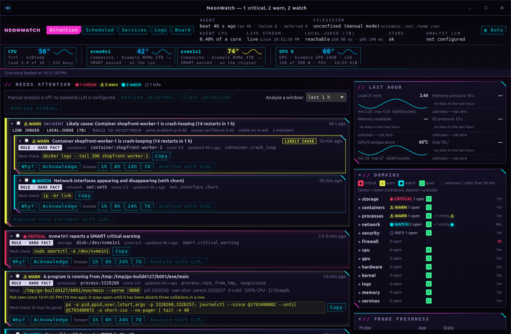

**The window.** The title bar carries the open counts. Closing the window hides it to the tray.
The app signs in by itself from the service's `dashboard.url`, and again whenever the service
restarts with a new token, staying on the same view or issue.

**The tray icon** is the eye, in the dashboard's severity colours:


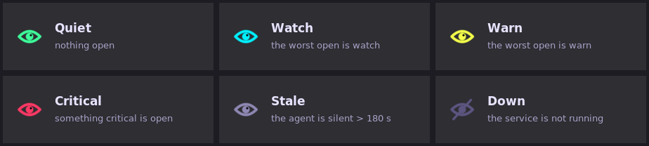

- **Precedence:** a critical issue outranks a silent agent, which outranks warn and watch. With
  nothing being watched, a quiet green eye would claim something nobody can know.
- **The tooltip** gives the counts and how recent the agent's heartbeat is.
- **The menu** has:
  - **Open NeonWatch**;
  - **Pause notifications for 1 hour**, which then reads "Resume notifications (paused, N min left)";
  - **Quit NeonWatch**, the only thing that ends the app.

**Notifications** open the app at their issue:

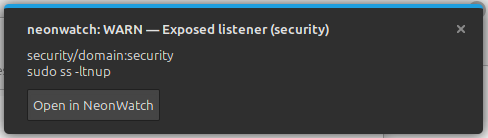

- **Cinnamon:** press **Open in NeonWatch**. Clicking a notification's body only dismisses it there.
- **GNOME and KDE:** a click on the body works as well.

**When the service is not running,** the window says so and offers to start it:

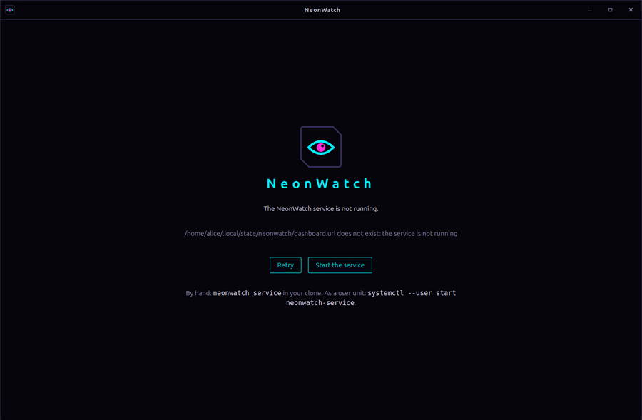

**Build and run** (Rust and the WebKitGTK headers):

```sh
sudo apt install libwebkit2gtk-4.1-dev libgtk-3-dev libayatana-appindicator3-dev librsvg2-dev libxdo-dev
cd desktop && cargo build --release
target/release/neonwatch-desktop            # or --hidden to start in the tray
```

> [!NOTE]
> Two pieces are not built yet:
> - **The service still sends its own notifications** with `gdbus`, and those cannot be clicked
>   through. It notifies an issue once per severity it reaches (`[notify]`), and a restart does not
>   repeat it. The app's own notifications can be clicked through, today, from
>   `neonwatch-desktop --notify '<json>'`.
>   Handing the service's notifications to the app is the next step.
> - **Installing the app** (a menu entry, `neonwatch://` links and autostart) comes after that.

[`desktop/README.md`](desktop/README.md) has everything else:
- every command-line form;
- how the app signs in and follows the service;
- its security posture: the dashboard gets no IPC, and only the dashboard's own origin loads in the window;
- its limits.

## Configure

No file is a valid configuration. To change anything, start from the example, in which every line
is commented out:

```sh
mkdir -p ~/.config/neonwatch
cp examples/config.toml ~/.config/neonwatch/config.toml
```

It must be a regular file you own. **A symlink is refused**, so if you use a dotfile manager,
copy rather than link. An unknown section or key stops every command that reads the config,
with an error that names it. The processes read the file when they start, so restart them after an edit.
[`docs/configuration.md`](docs/configuration.md) documents every key.

**The two models need no restart.** The dashboard's **Models** tab sets which judge and which
analyst LLM the service calls, and their keys, and applies a change at once. It writes over
`config.toml` without touching it, and keeps keys in a separate file only you can read. It works
from this machine's own dashboard only, never in LAN mode.

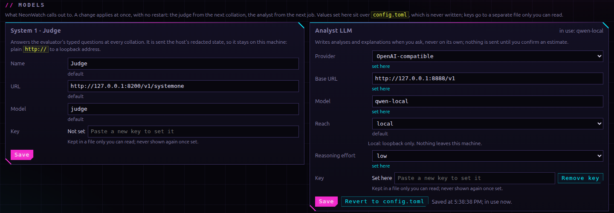

### The two models

NeonWatch can use two optional models. The **judge** is a fast "System 1" classifier, asked
automatically at every collation, that ranks what the rules can't judge. The **analyst** is a
"System 2" language model that explains things in prose when you ask.
[`docs/models.md`](docs/models.md) covers both in full: what each sees and can do, every setting,
recipes for local, LAN and hosted models, and how to tell each is working.

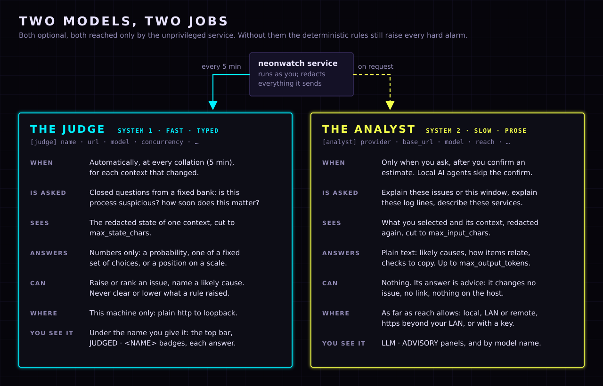

### Name and connect a judge

The judge is a model server that answers NeonWatch's closed questions: a probability, one choice
from a fixed set, or a position on a scale, never prose. It can raise an issue or rank it higher,
but never clear or lower one that a rule raised. **NeonWatch does not ship a judge.** Run any
server that speaks [`docs/judge-protocol.md`](docs/judge-protocol.md) on this machine, and tell
NeonWatch what to call it:

```toml
[judge]
name  = "Qwen 7B judge (GPU 0)"                  # your label for this model at this endpoint
url   = "http://127.0.0.1:8200/v1/systemone"     # plain http, loopback only
model = "qwen-7b-judge"                          # sent with each request
```

The name is how NeonWatch refers to that model at that endpoint, so make it say what you would
want to know at a glance. It titles the top bar's vital (hover for the model and URL), it labels
every `JUDGED · …` badge and *attestations* heading, it heads the judge column in Scheduled and
Services, and it appears in `/api/health`. Each answer records the name it was given under, so
after you switch models the old answers still say which judge gave them.

### Add an analyst

An analyst is any OpenAI-compatible or Anthropic model that explains selected issues, journal
lines or services in plain text. It is off until you set it:

```toml
[analyst]
provider    = "openai-compatible"           # or "anthropic"
base_url    = "http://127.0.0.1:8000/v1"
model       = "your-model"
reach       = "local"                       # "lan" for a private address; "remote" for anywhere (https)
api_key_env = ""                            # the NAME of an environment variable, never the key
```

For Anthropic, set `provider = "anthropic"`, leave `base_url` empty, and set
`reach = "remote"` and a key. Its API is on the internet, and with `reach = "local"` the
config is refused. Paste the key into the Models tab, or export the variable `api_key_env` names in
the terminal you start the service from; the dashboard's key wins. A variable exported in a
terminal does not reach the `neonwatch-service` user unit, so there use the Models tab. With
neither, the service logs `analyst disabled: …` and carries on without one. The dashboard shows
an estimate of what will be sent where, and sends nothing until you confirm it.

### Draw your own board

The Board view uses a generic ATX layout until you give it yours: `[web] board = "<path to a
.toml>"`. [`docs/board-layouts.md`](docs/board-layouts.md) describes the format, and
[`examples/boards/`](examples/boards/) has a worked example for a common board to copy from.

### Connect AI agents

Agents on this machine read everything and can hold issues through `/api/agent/v1`, or the stdio
MCP server `neonwatch mcp`, with the token in `~/.local/state/neonwatch/agent.token`
(`.venv/bin/neonwatch agent-token --rotate` replaces it). Writes are limited to 30 a minute per agent and 60
in all, and every one is audited. With Claude Code, from the clone's root:

```sh
claude mcp add --scope user neonwatch -- "$PWD/.venv/bin/neonwatch" mcp
```

> [!WARNING]
> Agents start analyst jobs **without** the estimate-and-confirm step. With
> `analyst.reach = "lan"` or `"remote"`, anything that can read the agent token can send redacted
> host data off this machine without a click from you. Reference:
> [`docs/agent-api.md`](docs/agent-api.md).

<details>
<summary><b>The dashboard on your LAN</b></summary>

A LAN address needs TLS, a password and the exact host names browsers will use. Make a password
hash and a self-signed certificate (edit the names and the address):

```sh
.venv/bin/neonwatch hash-password        # prints a password_hash = "…" line
mkdir -p ~/.config/neonwatch
openssl req -x509 -newkey ec -pkeyopt ec_paramgen_curve:prime256v1 -nodes -days 825 \
  -subj "/CN=myhost" -addext "subjectAltName=DNS:myhost,DNS:myhost.local,IP:192.168.1.50" \
  -addext "basicConstraints=critical,CA:FALSE" -addext "extendedKeyUsage=serverAuth" \
  -keyout ~/.config/neonwatch/tls.key -out ~/.config/neonwatch/tls.crt \
  && chmod 600 ~/.config/neonwatch/tls.key
```

```toml
[web]
host          = "0.0.0.0"                     # or one address
password_hash = "scrypt$…"                    # the line hash-password printed
tls_cert      = "~/.config/neonwatch/tls.crt"
tls_key       = "~/.config/neonwatch/tls.key"
allowed_hosts = ["myhost:8765", "myhost.local:8765", "192.168.1.50:8765"]   # lower case, with the port
```

The service refuses a LAN `host` without all of these, and a key that others can read. Bound to
one specific address, nothing listens on loopback, so local AI agents cannot reach the agent API.
Use `0.0.0.0` for both.

</details>

## How an issue is raised, and how to read it

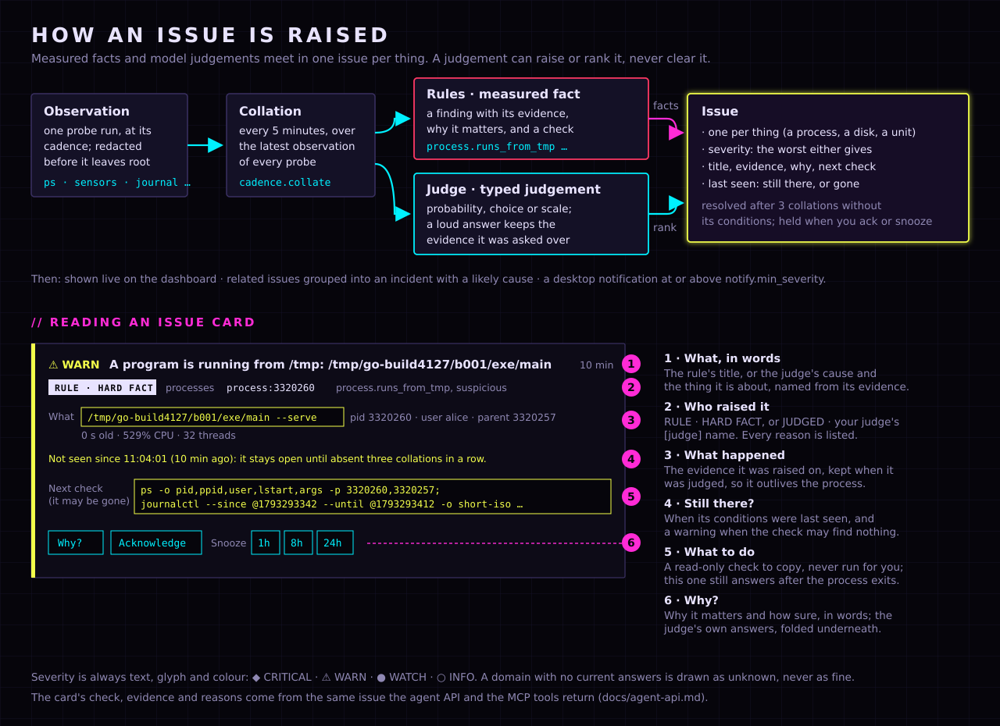

Here is that card in the dashboard, opened with *Why?*. It says why it matters and how sure the
monitor is, and folds the judge's own answers underneath.

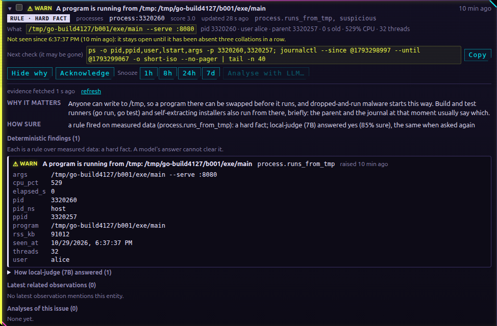

## Troubleshooting

Find what you were doing, then the start of the message you saw.

**Starting the broker, service or agent**

- `cannot run broker.binary` → run `scripts/fetch-nats-server`, and start the broker from the
  clone's root.
- `cannot read credentials` → the broker hasn't run yet. Start it first; it makes them.
- `could not connect to nats://127.0.0.1:4222` → the broker isn't running.
- `must not run as root` → drop `sudo`. Only the agent runs as root.
- `the agent must run as root, and only through the wrapper` → `sudo scripts/neonwatch-agent`.
- `refusing to run outside Python's isolated mode` → use the wrapper, not `.venv/bin/neonwatch
  agent` or `uv run`.
- `SUDO_UID and SUDO_USER are not both set`, or `sudo was run by root` → run `sudo` from your own
  account, not a root shell.
- `address already in use` → something holds the port. `ss -ltnp 'sport = :4222'` (or `:8765`)
  shows what. On a shared machine, treat an owner you don't know as hostile; otherwise move
  `[broker] url` or `[web] port`.

**The config file**

- `a symlink is refused` → copy the file in, don't link it.
- `owned by uid …` → `chown` the file to yourself.
- `has unknown key(s)` → a typo; check [`docs/configuration.md`](docs/configuration.md).
- `judge.name must be 1-40 characters` → letters, digits, spaces and `. _ - + / ( )`, starting
  with a letter or digit.

**The judge and the analyst**

- `judge.url must be loopback` → the judge has to run on this machine.
- `is not loopback and analyst.reach is "local"` → set `reach` to `"lan"` or `"remote"`, knowing
  what that sends where.
- `analyst disabled` in the service's log → set the key in the Models tab, or export the key's
  variable in the terminal you start the service from.

**The dashboard and the probes**

- Browser shows `unexpected Host header` → use `127.0.0.1` or `localhost`, or a name listed in
  `allowed_hosts`.
- A probe shows `cannot exec /usr/bin/…` → that tool isn't installed. Install it or ignore it;
  the rest still runs.
- A probe shows `refused /usr/bin/…` → a probe binary, or a directory above it, isn't owned by
  root. Find out why before anything else.

## Known limitations

- **The agent unit's capability set is a first cut.** Each capability is there for a named
  probe, but which probes lose data under the sandbox depends on the host; check the unit's
  journal on its first run. The agent accounts its own CPU against a 1% budget and defers its
  heavier probes as it nears it; the unit adds a 50% CPU ceiling for a runaway, not the budget.
- **Started by hand, root runs user-owned code** (see *Before you run it as root*). The system
  service does not.
- **The broker and service user units are not sandboxed** beyond `NoNewPrivileges`; they run as
  you, from the clone.
- **A single-user machine is assumed.** The broker and the judge are plain TCP on loopback, and
  nothing authenticates the server to the client. Another local account that binds 4222 or 8200
  first would receive the agent's redacted observations or the judge's questions.
- **Tested on one machine.** The catalog's command paths are Debian/Ubuntu-style. A binary
  anywhere else is refused, not searched for.

## Documentation

| | |
| --- | --- |
| [`docs/configuration.md`](docs/configuration.md) | every config key, its default and its rule |
| [`docs/models.md`](docs/models.md) | the judge and the analyst: what they do, every setting, recipes |
| [`docs/judge-protocol.md`](docs/judge-protocol.md) | the wire a judge server speaks |
| [`docs/board-layouts.md`](docs/board-layouts.md) | writing a layout for your motherboard |
| [`docs/agent-api.md`](docs/agent-api.md) | the agent API and MCP tools |
| [`docs/design.md`](docs/design.md) | the design, the security model and the decisions behind them |
| [`docs/probes.md`](docs/probes.md) | what each probe reports |
| [`desktop/README.md`](desktop/README.md) | the desktop app: building, signing in, notifications, the tray, its security |

## Development

```sh
uv sync --extra dev
scripts/fetch-nats-server                 # the broker and bus tests run a real nats-server
.venv/bin/pytest -q                       # the whole suite
.venv/bin/python tools/gates.py           # components, levels, insulation, read-only, catalog
.venv/bin/ruff check neonwatch/ tools/ scripts/
.venv/bin/python scripts/make-screenshots.py   # re-render docs/images (needs google-chrome)
```

Each module has a sibling `<name>_test.py`. `plan.json` is the machine-readable physical design
that `tools/gates.py` enforces. Adding a probe means editing both `neonwatch/probes/catalog.py`
and `APPROVED_ARGV` in `tools/gates.py`, after reading the tool's manual for every flag.

## Security

Please report a vulnerability through a GitHub security advisory on this repository, not a public
issue. See [`SECURITY.md`](SECURITY.md).

## Licence

Apache License 2.0; see [`LICENSE`](LICENSE).
