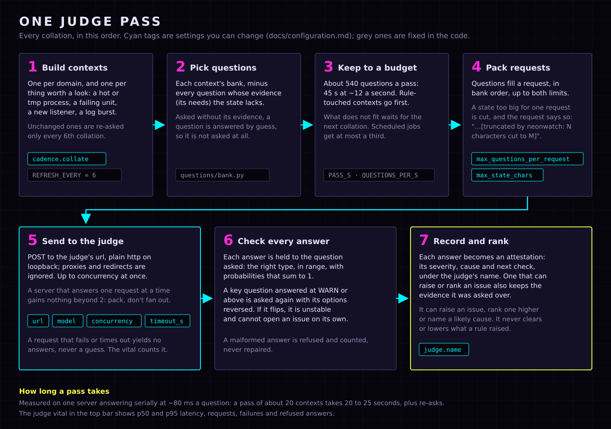
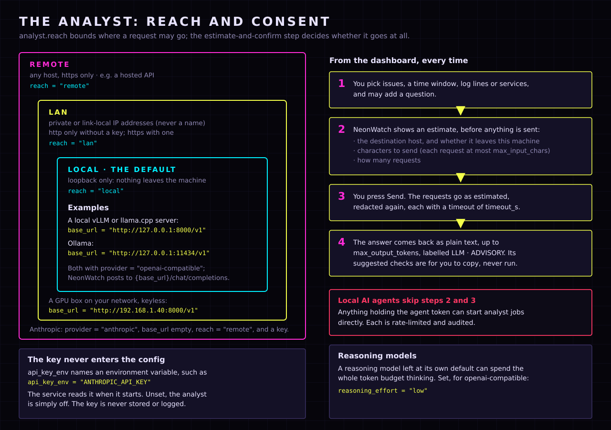

# The models: the judge and the analyst

NeonWatch can use two models, for two different jobs. Both are optional. Without either, the
deterministic rules still raise every hard alarm, and the dashboard works in full.


|                     | The judge (`[judge]`)                          | The analyst (`[analyst]`)                          |
| ------------------- | ---------------------------------------------- | -------------------------------------------------- |
| **Kind of model**   | A fast classifier: "System 1"                  | A general language model: "System 2"               |
| **Runs**            | Automatically, every collation (5 minutes)     | Only on request                                    |
| **Answers**         | Numbers: a probability, a choice, a scale      | Plain text                                          |
| **Effect**          | Raises or ranks issues; names likely causes    | None: advice for you to read                       |
| **Where it may be** | This machine only (loopback)                   | Local, your LAN, or remote, as `reach` allows      |
| **You need**        | A server that speaks the [judge protocol](judge-protocol.md) | An OpenAI-compatible server, or an Anthropic key |

"System 1" and "System 2" are Kahneman's names for fast, automatic judgement and slow,
deliberate reasoning. The judge is the first kind: many small, closed questions about what
changed, answered in milliseconds, with answers whose shape NeonWatch checks. The analyst is the
second kind: an occasional, open question about a handful of issues, answered in prose.

Only the unprivileged service talks to either model, and it redacts everything it sends. The
root agent has no model client at all.

## Setting them from the dashboard

Both can be set in `config.toml` (below), or in the dashboard's **Models** tab. The tab applies a
change at once, with no restart, and keeps keys in a separate file only you can read:


- **Where values come from.** Every field says whether it was set here, comes from
  `config.toml`, or is the default. An edited field says it is not saved yet.
- **Keys** are set by pasting into the key field. They are never shown again, only whether one is
  set and where from.
- **One form per model.** Each has **Save**, and **Revert to config.toml** once it has been
  changed here.
- **What may be set** is checked whole by the same rules as `config.toml`. The judge stays on this
  machine, and the analyst keeps its `reach`. A refusal says why and changes nothing.
- **Only from this machine's own dashboard**, never in LAN mode.

The details, and the two files it keeps, are in
[`configuration.md`](configuration.md#set-from-the-dashboard-modelsjson-and-secretsjson).

## The judge

### What it does

At every collation, the service builds a *context* for each domain (hardware, storage,
processes, network...) and for each thing worth a look (a hot process, a failing unit, a new
listener, a burst of log lines). It then asks the judge that context's questions from the bank
in `neonwatch/questions/bank.py`. Some examples:

- **Yes or no, as a probability:** "Is this process suspicious?"
- **One of a fixed set of choices:** "Which action class fits: ignore, watch, investigate, act
  now?"
- **A position on a scale:** "How soon should a person look at this?"

Each answer becomes an *attestation*: a severity, a cause, a suggested check and, when it can
raise or rank an issue, the evidence it was asked over. Attestations can open an issue the rules
did not raise, rank one higher, or name the likely cause when several issues are related. **They
can never clear or lower an issue a rule raised.**



### Running one

NeonWatch does not ship a judge. Any HTTP server on this machine that speaks
[`judge-protocol.md`](judge-protocol.md) will do: it takes a JSON body of a state and a set of
typed questions, and returns one typed answer per question. A small instruction-tuned model
behind a thin adapter works. What matters is that it answers quickly and in the exact shape
asked for: a malformed answer is refused and counted, never repaired or guessed at.

### Settings

```toml
[judge]
name = "Qwen 7B judge (GPU 0)"
url = "http://127.0.0.1:8200/v1/systemone"
model = "qwen-7b-judge"
concurrency = 2
max_questions_per_request = 24
max_state_chars = 24000
timeout_s = 60
```

| Key | Default | What it does, and when to change it |
| --- | --- | --- |
| `name` | `"Judge"` | What the dashboard and the APIs call this judge: the top-bar vital, every `JUDGED · …` badge, the judge column, `/api/health`. Each answer records it, so answers keep the name they were given under after you switch models. Name the model *and* where it runs. |
| `url` | `http://127.0.0.1:8200/v1/systemone` | Where requests go. Plain `http://` to a loopback address only. The service refuses to start otherwise, and ignores proxies and redirects. |
| `model` | `"judge"` | Sent in every request, for a server that hosts several models. A server may ignore it. |
| `concurrency` | `2` | Requests in flight at once, 1 to 16. A server that answers one request at a time gains nothing past 2; raise it only for one that batches. |
| `max_questions_per_request` | `24` | Questions packed into one request. Lower it if your server has a per-request limit. |
| `max_state_chars` | `24000` | State plus questions per request, in characters. Size it to the model's context window: 24000 suits a 16K-token context. A larger state is cut, and the request says so. |
| `timeout_s` | `60` | Per request. A request that times out yields no answers, never a guess. |

Two related settings live elsewhere. `[cadence] collate` (default 5 minutes) is how often a pass
runs, and unchanged contexts are re-asked only every 6th pass. Each pass keeps to a budget of
about 540 questions (45 seconds at a measured 12 a second). What doesn't fit waits for the next
pass, contexts a rule touched go first, and scheduled jobs get at most a third.

### Is it working?

The top bar's judge vital, titled with your `name`, says one of:

- **not asked yet**: the service has started and no pass has run.
- **reachable**, with p50 and p95 latency: answering. Hover over it for the model, the URL and
  the counts of requests, failures and refused answers.
- **unreachable**: nothing answered at `url`. Hover for the last error. Everything else keeps
  working.

## The analyst

### What it does

The analyst explains things in prose, when you ask:

- **Analyse:** on the Attention view, explain selected issues (*Analyse selected…*), a time
  window (*Analyse window…*), or an incident (*Explain this incident with LLM…*). On a scheduled
  job or service, *Analyze with LLM…*.
- **Explain logs:** on the Logs view, a plain-language line for each kind of journal message
  (*Explain N new…*). Explanations are cached, so a kind is explained once.
- **Describe services:** on the Services view, a one-line description of what each unit is for
  (*Describe N services…*).

It is shown what you selected, with related context: observations, findings, the judge's
attestations and issues, all redacted again before sending. It is told that everything in
them is data, not instructions. Its answer is labelled `LLM · ADVISORY`. It changes no issue,
no link, and nothing on the host. The checks it suggests are for you to copy, never run.



### Settings

| Key | Default | What it does, and when to change it |
| --- | --- | --- |
| `provider` | `""` (off) | `"openai-compatible"` (vLLM, llama.cpp, Ollama, LM Studio, most hosted APIs) or `"anthropic"`. |
| `base_url` | `""` | For openai-compatible, the base that `/chat/completions` hangs off, such as `http://127.0.0.1:8000/v1`. For anthropic, leave it empty to use `https://api.anthropic.com`. |
| `model` | `""` | The model name the server expects. Required once `provider` is set. The dashboard's buttons use its family: "Describe with Qwen". |
| `reach` | `"local"` | How far a request may go: `"local"` (loopback), `"lan"` (private and link-local IP addresses, never a name, since a name could resolve anywhere) or `"remote"` (anywhere). Checked when the config loads, and again before every send. |
| `api_key_env` | `""` | The **name** of the environment variable holding the key. The service reads it when it starts; if it is unset, the analyst is off and the log says why. A value that looks like a key is refused. |
| `reasoning_effort` | `""` | openai-compatible only: `"low"`, `"medium"` or `"high"`, sent as `reasoning_effort`. Set it for a reasoning model, which at its own default can spend the whole token budget thinking. |
| `max_input_chars` | `60000` | Characters of redacted context per request. |
| `max_output_tokens` | `2000` | The longest answer. |
| `timeout_s` | `120` | Per request. |

Plain http is allowed to loopback, and to a LAN address only without a key. Everything else
needs https, so neither a key nor the host's data ever travels in clear text.

### Recipes

**A local server** (vLLM, llama.cpp, Ollama), nothing leaving the machine:

```toml
[analyst]
provider = "openai-compatible"
base_url = "http://127.0.0.1:11434/v1"      # Ollama; vLLM is usually :8000/v1
model = "qwen2.5:14b"
```

**A GPU box on your network**, no key:

```toml
[analyst]
provider = "openai-compatible"
base_url = "http://192.168.1.40:8000/v1"
model = "your-model"
reach = "lan"
reasoning_effort = "low"                    # if it is a reasoning model
```

**Anthropic:**

```toml
[analyst]
provider = "anthropic"
model = "your-claude-model"
reach = "remote"
api_key_env = "ANTHROPIC_API_KEY"
```

Then start the service from a terminal where that variable is set:
`ANTHROPIC_API_KEY=… .venv/bin/neonwatch service`.

### Consent, and the one exception

From the dashboard, every analyst request starts with an estimate: the destination host,
whether the request leaves this machine, how many characters and how many requests. Nothing is
sent until you press *Send*.

**Local AI agents using the agent API skip that step.** Anything that can read
`~/.local/state/neonwatch/agent.token` can start analyst jobs directly. Each start is
rate-limited and audited. With `reach = "lan"` or `"remote"`, that means redacted host data can
leave the machine without a click from you, so keep the analyst `local` unless you want that.

### Is it working?

The top bar's *Analyst LLM* vital shows the model name and provider, or "not configured". If
you set an `api_key_env` that the service's environment lacks, the service log says
`analyst disabled: analyst.api_key_env names …, which is not set in the service's environment`.

## Both at once

```toml
[judge]
name = "Qwen 7B judge (GPU 0)"
url = "http://127.0.0.1:8200/v1/systemone"

[analyst]
provider = "openai-compatible"
base_url = "http://127.0.0.1:8000/v1"
model = "qwen2.5-32b-instruct"
```

They don't talk to each other. The judge works continuously and in the background, and its
answers become part of what the analyst is shown when you ask about an issue. The full list of
keys, defaults and rules is in [`configuration.md`](configuration.md).
